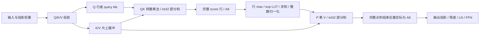

# Attention 行流式与全局缓冲实验

本次固定全 W4、普通激活 A8，比较两种全局格式：指数 Q15/概率 P7、LayerNorm Q12/Q12；指数 Q15/概率 P11、LayerNorm Q16/Q16。矩阵乘加及其部分和、bias 相加、残差相加使用受检查的 int32；LayerNorm 等统计临时量继续按独立宽整数规则执行。

## 数据流边界

一个 Transformer block 内可按 query 行或小 tile 执行：



每个 score 行必须完成后才能确定该行 max，随后求完整指数和，再归一化。保持原 LUT、截断、最近偶数舍入、饱和及重定标时，行调度可以保持数值逐位一致。归约维度的 tile 之间不能先降成 A8：必须保留 int32 部分和，完成整个点积后再统一重定标。

这里的流水跨越同一个 block 内的若干算子。下一个 Transformer block 的注意力依赖全部 token，因此不能直接把一个 token 连续送过全部 12 个 block。

## 缓冲与复用

K/V 是投影后的中间激活，投影权重是模型参数。二者需要分别安排驻留与复用。

- K 和 V 各 `99×64×1 = 6,336` 字节，合计 12,672 字节。
- 每个 block 的六个矩阵共 49,152 个权重，全 W4 打包后 24,576 字节；12 个 block 合计 294,912 字节，不含 bias/scale/LUT。
- 单行 context 的 64 个 int32 累加器需要 256 字节；8 行需要 2,048 字节。
- score 点积部分和若保留整个 query tile，单行需要 396 字节；8 行需要 3,168 字节。顺序计算单个 key 可进一步减少同时存活的累加器。

K/V 常驻片上可避免每个 query 重新从总线读取。若不保留 K/V，单行方案每个 block 读取 `99×12,672 = 1,254,528` 字节；8 行 tile 读取 `ceil(99/8)×12,672 = 164,736` 字节。保留后均只需先加载 12,672 字节，之后是片上访问。

片上容量充足不等于 SRAM 带宽充足。让一个 K/V 元素广播给 tile 内多个 query，才可同时减少片上读取；若仍逐行计算，片上 K/V 仍需反复读取。需要结合 MAC 并行度、bank/端口和寄存器复用安排数据流。

16 位 SRAM 字可以打包两个 A8 值以保持上述字节容量。U12 概率若一项占一个 16 位字，容量与 U16 相同。实际宏取整、bank、端口和时序约束尚未计入。

## Softmax 缓冲进一步简化

完整 `99×99` 概率矩阵可避免存储。保留一行 score 以完成减 max，随后保留一行 Q15 指数完成求和；逐项计算概率后即可广播给对应 V 行，更新 64 个 int32 context 累加器，甚至不必保存完整 P 行。

此方式可减少概率 SRAM，但归一化与 P×V 的吞吐需要匹配。P7 的单项编码最大为 128，P11 为 2048；指数编码最大为 32768，需要 16 位无符号数。Q15/P7 的归一化分子最大 `2^22`，Q15/P11 最大 `2^26`；99 项指数和最大 3,244,032。除法的舍入/余数路径仍须单独定义，不能仅根据输出精度选择容器。

## 可恢复执行

在仓库根目录使用独立 `kwt-quant` 环境：

```sh
python -B -u quantization/scripts/run_global_w4_modes.py --workers 4
python -B -u quantization/scripts/verify_softmax_row_stream.py --samples 24
python -B quantization/scripts/report_attention_dataflow.py
python -B -u quantization/scripts/finalize_global_w4_modes.py
```

全局格式评估每 32 条保存进度；配置和数据身份一致时自动恢复。输出分别为实验目录 `reports/global_w4_modes.json`、`reports/softmax_row_stream.json`、`reports/attention_dataflow.json/.md`。最后一条命令要求完整评估已完成，导出两种格式的 golden/算子向量并核验二进制重载，生成 `reports/global_w4_modes_delivery.json` 与汇总 `reports/global_w4_modes.md`。

行/tile 等价性核对覆盖预先固定的 24 条验证 golden、12 个 block、query tile=1/8，比较 score、P 和 context，并逐步检查每个点积部分和的 int32 范围。它验证软件调度等价性，不替代 RTL 对照、总线实测或 SRAM/逻辑综合。

优先评估 K/V 常驻、当前 block 权重缓存、query tile=1/8 两种调度。64 KiB 可作为容量探索起点；能否放入全部存活张量取决于数据生命周期复用、bias/scale、bank/端口及实际 SRAM 宏，不在软件阶段断言一定足够。
